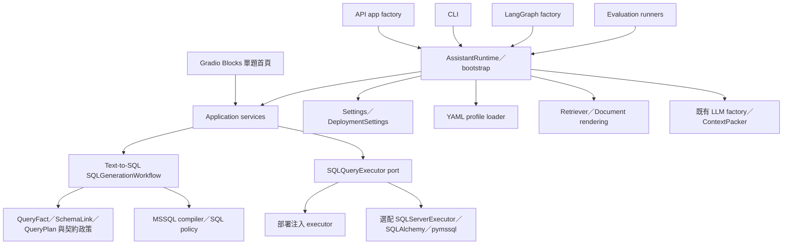

# CPEA 架構

目前產品為 `src/cpea` 的單一 Python package，驗證平台為 Windows x64／Python 3.12。核心提供單一 View MSSQL 產生、選配 SQL Server 執行與 Gradio 單題首頁；其他 API 接入與企業級 enforcement 狀態見 [企業級設計](enterprise_design.md)。



## 目錄與依賴

| 位置 | 責任 |
|---|---|
| `bootstrap.py` | 集中組裝，LLM／retriever／packer 延遲建立，profile 啟動驗證 |
| `config/` | 明確 env 優先順序、部署設定與相對路徑解析 |
| `interfaces/api/`、`interfaces/cli/`、`interfaces/web/` | JSON／SSE／命令列入口、Gradio UI 與錯誤映射 |
| `application/services/` | generation、核准 SQL execution、typed staged query、answering |
| `application/ports/` | CatalogProvider、SQLQueryExecutor；application 不依賴 DB driver |
| `application/models/`、`catalog_contract.py` | Service read models、trace、既有契約政策與 prompt rendering |
| `domain/` | QueryFact、SchemaLink、QueryPlan、ViewDefinition 等核心概念 |
| `workflows/text_to_sql/` | SQL generation graph、LLM draft schema 與 graph factory |
| `infrastructure/database/` | 選配 SQLAlchemy／pymssql adapter（NullPool），綁定 datasource／View、有限讀取、逾時與資源釋放 |
| `infrastructure/catalog/` | 有路徑邊界的 YAML snapshot loader |
| `infrastructure/retrieval/` | LangChain Document 轉換、lexical／vector retrieval、rerank 與 cache |
| `infrastructure/llm/` | 既有模型 factory、共享 JSON parsing、token/context budget |
| `infrastructure/sql_compiler.py`、`sql_policy.py` | 保留既有 MSSQL renderer／唯讀 SQL 檢查 |
| `examples/demo-profile/` | 明確選用的合成示例；不是客戶資料，也不是 runtime 預設值 |
| `projects/<project-id>/` | 私有專案 View 契約、`.env`、單一題庫與評估產物；wheel／sdist 排除 |
| `evaluations/` | 共用品質工具與合成 fixture；原始私有 PoC 題庫封存於被忽略的 `artifacts/baseline/` |

Domain 不 import API；application 回應模型由 API 引用。API／CLI／Graph 使用 bootstrap 建立依賴。Provider-specific LLM／retrieval 的現有抽象沿用 LangChain，沒有另外引入通用 plugin 平台。

## 既有生成與執行

```text
retrieve_schema → match_candidates → compile_query → finalize
```

Graph 只產生 QueryPlan／SQL／QueryTaskTrace；SQLExecutionAgent 顯式取得 executor 與 datasource 後執行一次，保留最大筆數、truncation 和 execution trace；AnswerSynthesisService 根據結果產生附來源的回答。未設定 executor／binding 時，在 generation／LLM 呼叫前回報 unavailable。TOP 和 SQL policy 不取代真實資料庫權限與負載限制。

檢索與 context budget 篩選後，模型同時比較候選 View 的核准契約，選出單一來源並回傳 `SQLClauseMapping`。候選資訊包含欄位描述、能力、可用及預設聚合、詞彙對應、範圍與 operator 政策；不把 samples、測試題庫或預期答案放入模型 context。正常成功路徑只需一次模型呼叫，仍保留有上限的格式／語意驗證嘗試。雲端 SDK 的隱藏重試停用，API 錯誤交由呼叫端處理。

Python 將 fields／criteria／group 轉為 QueryFact、SchemaLink 與 QueryPlan，再由既有 compiler 產生 MSSQL。`default_aggregation` 提供模型依據，不由 Python 自動覆蓋模型明確回傳的 null。條件值必須來自需求原文或契約明確的 term mapping，欄位與 View 必須在實際送出的候選契約內。檢查原文引用、欄位能力、operator／aggregation、catalog scope、QueryPlan 與唯讀 SQL policy；明確代碼、數值等 literal 若未承接，則拒絕查詢，避免漏掉篩選後擴大查詢。此檢查不等同完整自然語言解析。

Python 不依特定品號、客戶或題目補寫查詢，也不透過案例或答案修正模型。查詢只使用一個核准 View；來源參照保留實際選中的契約，候選與失敗嘗試留在 trace。

Catalog snapshot 保留各 View YAML 的 physical name、欄位能力、聚合、詞彙、範圍與時間語意。Manifest 指定 profile_id、contract_version、source_kind 和 catalog；loader 不限定 `gms2`。所有 resource 必須解析到該 profile 根目錄內；讀取 symlink 也以最終路徑檢查。契約內容 fingerprint 約束 cache，更新契約後需重新建立 runtime 取得新 snapshot。

不支援跨 View JOIN、SQL dialect 切換或新業務 workflow。未來 API operation 是獨立能力介面，設計列於 enterprise_design，不會強迫以 SQL 呼叫 API。

## 單題串流與 Gradio 首頁

`StagedQueryService` 以空 history 產生 `SQLStage`，檢查 supported、profile allowlist 與 query plan，再由 `SQLExecutionAgent.execute_generation()` 執行相同 SQL，回傳 `ResultStage`。驗證會以既有 compiler 重新編譯 plan 並比較 SQL，不再次呼叫 LLM。舊 `run()`／JSON query 行為及 execution trace、attempts、row bounding 保留；新流程不呼叫 AnswerSynthesisService。

SSE 端點在 ASGI send 完整 SQL frame 後才恢復迭代並開始 DB 工作，所有同步生成與 DB 工作都移至 threadpool。結果完成 JSON 編碼後才送出唯一 result／error 終止事件。介面明確轉換日期、Decimal、UUID、binary，且拒絕無法表示的型別與非有限數字；錯誤只對外提供固定訊息。內部新流程僅記錄失敗階段，不記錄原始例外、問題、SQL 或 rows。

Gradio Blocks 在 FastAPI `/` 掛載，使用 generator 提供完整畫面快照：最新問答、SQL、結果表格與輸入／送出狀態。工作階段各自使用暫存 lock 防止重複提交，不向模型傳送前一題內容。問題在傳給 Chatbot 前先 HTML escape，即使停用 Markdown 仍不依賴框架 sanitizer 作為純文字保證；SQL 使用 Code，結果使用字串資料表。少量 JavaScript 提供 Enter／Shift+Enter、中文 composition 防誤送出、空白攔截、live region 與 queue 傳輸失敗的固定錯誤提示。提交時立即隱藏舊畫面，待本題更新抵達後顯示；傳輸失敗不重新提交查詢。重新整理取得新工作階段，沒有問答持久化、browser storage 或 checkpoint；Gradio analytics 與 run history 均停用。

`AssistantSettings.sqlserver` 隱藏連線字串的 repr；設定沿用 process environment 與明確 env file 層。Bootstrap 只在沒有注入 executor 且連線字串非空時載入選配 driver，建立 adapter 時不連接資料庫。每次呼叫驗證 datasource 與單一核准 View 的 SELECT，套用登入／查詢 timeout，讀取至多 max_rows + 1 列，最後關閉 cursor 與 connection；不呼叫 commit、修復或重試。SQLAlchemy 使用 NullPool 取得獨立 raw_connection，pymssql 套用 login_timeout／timeout、UTF-8、TDS 7.4 與 read_only intent；底層可執行連線初始化／metadata 查詢，核准業務 SQL 仍只執行一次。TLS 預設要求加密、system CA 與 hostname 驗證，FREETDSCONF／FREETDS 可由既有 env 層提供並解析相對路徑。pymssql timeout 與 TLS 設定有程序共用效果，不同部署設定使用不同程序。資料庫 SELECT 權限仍由部署環境提供，schema 名稱不作為 database 預設值。

安裝與代理串流設定見 [README](../README.md)。離線測試與真實 GMS2 驗證分開記錄，缺少 driver、網路連線或權限時不能宣稱已連線驗證。
