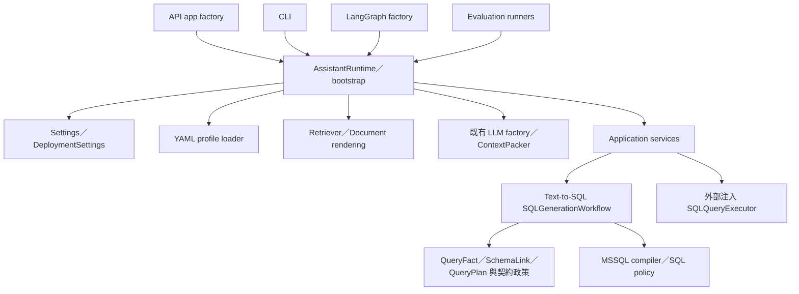

# CPEA 架構

目前產品為 `src/cpea` 的單一 Python package，驗證平台為 Windows x64／Python 3.12。核心提供既有單一 View MSSQL 產生能力；DB／API 接入實作與企業級 enforcement 狀態見 [企業級設計](enterprise_design.md)。



## 目錄與依賴

| 位置 | 責任 |
|---|---|
| `bootstrap.py` | 集中組裝，LLM／retriever／packer 延遲建立，profile 啟動驗證 |
| `config/` | 明確 env 優先順序、部署設定與相對路徑解析 |
| `interfaces/api/`、`interfaces/cli/` | HTTP／命令列入口，API DTO 與錯誤映射 |
| `application/services/` | generation、注入 execution、answering |
| `application/ports/` | CatalogProvider、SQLQueryExecutor；不提供 DB driver |
| `application/models/`、`catalog_contract.py` | Service read models、trace、既有契約政策與 prompt rendering |
| `domain/` | QueryFact、SchemaLink、QueryPlan、ViewDefinition 等核心概念 |
| `workflows/text_to_sql/` | SQL generation graph、LLM draft schema 與 graph factory |
| `infrastructure/catalog/` | 有路徑邊界的 YAML snapshot loader |
| `infrastructure/retrieval/` | LangChain Document 轉換、lexical／vector retrieval、rerank 與 cache |
| `infrastructure/llm/` | 既有模型 factory、共享 JSON parsing、token/context budget |
| `infrastructure/sql_compiler.py`、`sql_policy.py` | 保留既有 MSSQL renderer／唯讀 SQL 檢查 |
| `resources/demo/` | 可分發的合成示例；不是客戶資料 |
| `integrations/private/gms2/` | 原客戶契約／樣本，私有保存，wheel／sdist 排除 |
| `evaluations/` | 品質工具及合成題庫；private legacy 與 artifacts 分開 |

Domain 不 import API；application 回應模型由 API 引用。API／CLI／Graph 使用 bootstrap 建立依賴。Provider-specific LLM／retrieval 的現有抽象沿用 LangChain，沒有另外引入通用 plugin 平台。

## 既有生成與執行

```text
retrieve_schema → match_candidates → compile_query → finalize
```

Graph 只產生 QueryPlan／SQL／QueryTaskTrace；SQLExecutionAgent 顯式取得 executor 與 datasource 後執行一次，保留最大筆數、truncation 和 execution trace；AnswerSynthesisService 根據結果產生附來源的回答。未設定 executor／binding 時，在 generation／LLM 呼叫前回報 unavailable。TOP 和 SQL policy 不取代真實資料庫權限與負載限制。

Catalog snapshot 保留各 View YAML 的 physical name、欄位能力、聚合、詞彙、範圍與時間語意。Manifest 指定 profile_id、contract_version、source_kind 和 catalog；loader 不限定 `gms2`。所有 resource 必須解析到該 profile 根目錄內；讀取 symlink 也以最終路徑檢查。契約內容 fingerprint 約束 cache，更新契約後需重新建立 runtime 取得新 snapshot。

不支援跨 View JOIN、SQL dialect 切換或新業務 workflow。未來 API operation 是獨立能力介面，設計列於 enterprise_design，不會強迫以 SQL 呼叫 API。
