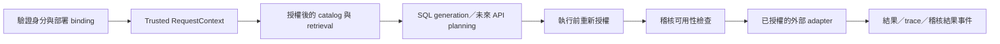

# 企業級能力接入設計

本文件對應 `enterprise-foundation-refactor`。權限、稽核、身分、平台限制與共享多租戶部分均為 **design-only**；文件中的介面名稱是未來責任契約，沒有 allow-all placeholder、runtime emitter、資料庫、ORM 或 migration 實作。

## 部署與識別

第一階段暫定每企業獨立部署，共用同一套產品程式。ERP 類型表示供應商／產品系列；integration profile 表示經治理的契約和 mapping；enterprise deployment 表示實際企業實例；physical schema 是 DB namespace。兩家企業即使使用相同 ERP、schema 與模型，也不能以 schema 名稱識別企業。

已實作的 DeploymentSettings 僅為可信任的部署設定載入：deployment_id、profile_path、datasource_id、secret_references。它不驗證登入使用者，不授予任何資料權限，不是共享 SaaS 的租戶管理器。

## Trusted RequestContext（design-only）

未來每次請求的 context 包含 request_id、principal_id、tenant_id、integration_id、授權 scope／policy version，以及 workflow_run_id。API 層從已驗證的 SSO／token 建立 principal 與 tenant；獨立部署也可由可信設定綁定 tenant，但仍需驗證操作者。使用者訊息、LLM 輸出或任意 payload 中的 tenant／datasource 值都不能直接作為授權來源。

Context 由 application service 明確傳遞，不使用可被請求修改的全域變數。trace、cache identity、adapter 與未來 checkpoint 都需要相同的可信 scope。缺少身分、tenant binding 或 policy 時，protected retrieval／execution 拒絕；不要讓 LLM 自行補齊。

## PolicyEnforcer（design-only）

概念契約為 `authorized_catalog(context, catalog)` 與 `authorize_operation(context, planned_operation)`。登入後先在 catalog 暴露／schema retrieval 前限制來源與欄位，避免模型已讀到未授權 schema；執行前再對實際來源、欄位、filters、operation、datasource binding 與 policy version 驗證。任何必須保留的企業／部門／列範圍不能由 LLM 移除。

不同部署日後可接 RBAC 或 ABAC；本次不決定政策儲存 schema。契約中已有的欄位能力與 scope rules 是查詢正確性和資源 allowlist，不能取代使用者權限。Python Protocol／Pydantic 型別也不是授權機制。

後續驗收須覆蓋：未登入、錯 tenant、錯 datasource、未授權欄位、列範圍被縮減／移除、policy 變更、跨企業索引或 state 汙染、執行前 policy 不可用等拒絕情境。

## AuditEvent 與 AuditSink（design-only）

Diagnostic QueryTaskTrace 用於核對需求與 SQL 的推導；它不是具備防竄改、可靠 delivery 與保存期限的稽核記錄。

| 欄位 | 意義 |
|---|---|
| event_id、event_type、event_version | 唯一事件識別、操作階段、事件契約版本 |
| occurred_at | UTC 時間；保存時另記 received_at |
| request_id、workflow_run_id、parent_event_id | 跨入口、workflow 與 adapter 的 correlation |
| tenant_id、principal_id、integration_id | 已驗證的企業、操作者與對接來源 |
| operation、resource_ids | generation／read／deny 等操作與來源 ID |
| policy_version、contract_version／fingerprint | 授權及資料契約的依據 |
| outcome、rejection_stage、error_code | accepted／denied／succeeded／failed 與可辨識原因 |
| duration_ms、rows_returned／truncated | 必要執行量度；不保存實際結果列 |

預設不收集 raw prompt、完整 SQL literals、rows、secret values 或 credential-bearing URLs。需額外診斷內容時由部署政策明確開啟，使用獨立受限紀錄，不能寫入一般稽核事件。

未來 AuditSink 的概念契約為 `record(event)`，回覆 delivery receipt 或可辨識失敗。以 event_id 去重，delivery 可採至少一次，接收方必須冪等；每個執行 run 以 request／workflow ID 關聯「執行前 accepted」與「執行後 outcome」。重試失敗不應再次執行 ERP 操作。

要求 durable audit 的部署，未取得執行前的可靠接收證據就拒絕 protected execution。執行後 sink 失敗時，必須標示 audit delivery failure、保留受限待補送資訊並通知維運，不能把 audit 靜默判為成功；具體可靠緩衝區與儲存由後續 change 設計實作。允許較低要求的診斷模式只能由部署設定明確選擇並揭露。

保存政策需由企業指定期限、資料所在區域、read/write 權限、刪除程序與例外保留。後續驗收包含 delivery failure、事件重複、時鐘偏差、跨企業讀取、retention／deletion、執行後失敗恢復及資料最小化。本次不提供 audit sink、查詢服務、事件 emitter 或 retention job。

## 機密與錯誤邊界（design-only）

企業設定保存 secret reference，例如 secret manager 的 key；真正的 DB／API credential 由部署方解析，adapter 初始化時注入。`.env` 僅為本機開發輸入，明確選取，排除於 Git／發行包。

未來 adapter 的 public diagnostic 使用穩定 error_code、correlation ID 及已遮罩訊息。Driver 例外可能包含 DSN、密碼、SQL 或資料列，原本 `_safe_error` 的長度截短僅限制大小，**不保證脫敏**；因此本次保留行為但不能把注入任意真實 executor 的錯誤內容視為正式可公開資訊。後續應設計 sanitizer 與受限 operational record，對一般日誌採 allowlist／redaction。

目前 Settings 的 repr 不顯示 API keys；評估 metadata 僅選取非機密設定欄位。這些改善不等同完整 secret manager 或全系統敏感資料防護。

## 資源限制（design-only，保留既有限制）

已保留單一 View、單次執行、欄位／operator allowlist、compiler TOP limit、context budget 與結果截斷。TOP／應用程式截斷不能單獨限制 DB 的扫描成本或執行時間。

未來 API 入口提供 request deadline／取消訊號；workflow 遵守總 budget；adapter 落實 DB statement timeout／API timeout、最大回傳量、paging、concurrency 和取消。Read retry 由 adapter 按可重試錯誤決定，不能由 LLM 臨時改 SQL；application 和 adapter 不重複套用無界 retry。跨步驟任務的 budget 規則留待新 workflow change。

## 隔離（design-only；本次仅驗證 profile 資源與 cache）

| 資源 | 未來必須納入的隔離識別 |
|---|---|
| catalog／向量索引／retrieval cache | tenant、integration、契約 fingerprint、policy scope、embedding 設定 |
| DB connection／API session | tenant、datasource、credential reference 與授權 scope |
| history／workflow state／checkpoint | tenant、principal／conversation、workflow_run_id |
| trace／evaluation／audit artifacts | tenant、run ID、資料分類與保存政策 |

本次 cache 包含 profile identity、contract version／fingerprint 與 retrieval／embedding settings，並使用不同 synthetic profile 做回歸。這不包含 per-user policy 過濾，不是共享服務的完整隔離驗收。

## ERP API boundary（design-only）

未來 ERPReadOperationExecutor 接收已註冊 operation ID、型別化參數、RequestContext 和 deadline；部署端指定 base URL 與 credential reference，使用者或 LLM 不傳入任意 URL。Operation allowlist 需描述 input schema、唯讀性、paging、最大資料量、錯誤映射與來源欄位。

OperationResult 概念上包含 typed data、source IDs、時間／期間、單位／幣別、truncation／paging 狀態及可追溯 provenance；由 API adapter 或 SQL result mapping 提供。無法映射的粒度、單位、歷史時點或空資料狀態明確保留，不自動推測。SQL workflow 仍使用 SQLQueryExecutor，不要求所有 ERP operation 假裝為 SQL。

## Readiness、升級與回復

未來 readiness 分開 generation、model dependency、authorized execution 和 audit dependency。已實作的未設定 executor／binding preflight 返回明確 unavailable，不阻止純 generation 啟動；本次沒有新增平台 health endpoints 或 monitoring service。

部署與回復以應用版本、非機密部署設定、匹配的契約版本／fingerprint 為同一交付單位。停止接收新請求、處理既有 run、切換一致版本並驗證 readiness；回復三者一起恢復。敏感機密由原 secret manager 保存。本次無 DB schema 變更，沒有 DB migration／rollback。

## 狀態與後續 change

| 狀態 | 內容 |
|---|---|
| implemented | 獨立套件、設定來源、profile 契約、catalog／executor ports、組裝、入口、既有 workflow 與離線回歸 |
| design-only | Trusted context、PolicyEnforcer、AuditEvent／Sink、secret／resource／tenant 邊界與商用 gate |
| deferred | 真實 DB／ERP API adapter、DB driver／pool／timeout、SSO、RBAC／ABAC、durable audit／retention、共享多租戶 runtime |

後續 change 分別規劃 ERP adapters、身分與授權、稽核與保存、共享服務隔離、部署維運。正式商用前須完成該部署模式的授權／跨企業隔離測試、真實資料語意確認、依賴錯誤脱敏、durable audit、負載與故障恢復、機密治理與維運驗收。PoC 品質門檻及本次重構完成均不能代替這些 gate。
