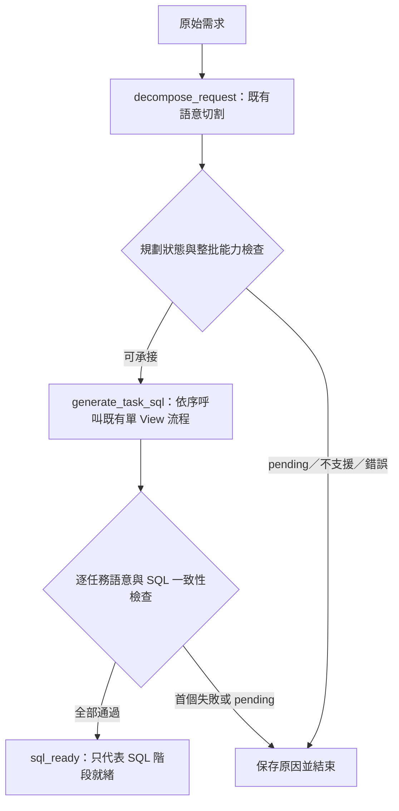

# CPEA 查詢 Agent 整合任務

> **執行方式：**由使用者依序實作。第一階段的逐項步驟見 [subtask-detail.md](subtask-detail.md)。本文件不是執行授權；不得自動實作、提交、推送或呼叫付費模型。使用 agent 執行時，依使用者指定方式採用 `superpowers:executing-plans`，不自行委派。

**目標：**整合語意切割與單 View text-to-SQL，逐階段建立能理解需求、取得可靠資料、保留證據，且每個節點可獨立驗證的查詢系統。

**架構：**先用獨立 LangGraph 包裝現有兩段服務，加入結構化交接、能力檢查及語意一致性驗證；再依序加入資料庫執行、資料整合、相依任務、受控回饋與附證據回答。LLM 負責需求理解及規劃；SQL 編譯、資料驗證及結果整合使用確定性程式。

**技術：**既有 Python 3.12、Pydantic 2、LangGraph、LangChain、pytest、受治理 View catalog、SQL compiler 與 SQL Server／PostgreSQL adapter。第一階段不新增產品依賴。

**規格來源：**本次對話中確認的整體開發路線及「先建立薄的雙節點 LangGraph，保留兩段獨立驗證」方向；本文件定義範圍，子任務文件定義實作與驗收。

**建立日期：**2026-10-22，Asia/Taipei。

**文件基準：**`11d55a5`，分支 `feat/progressive-view-retrieval`，已合併 `feat/cross_view`。開始實作前重新記錄實際 HEAD 與工作目錄狀態。

## 全域限制

- 第一階段驗收到 SQL 生成與契約一致性；不執行 DB、不合併實際資料、不產生業務結論。
- 兩個核心 node 是現有服務的包裝；不將研究用 Recall／Coverage／Selection 原型直接升為產品入口。
- 保留既有 CLI、網頁、API 及單題服務行為；新流程先由獨立 service 與評估 runner 使用。
- 模型輸出是待驗證資料；不得靠模型自評或 `status=ready` 略過契約、SQL policy 與 compiler 驗證。
- 原始需求、核准任務、實際交接及生成計畫分開保存；不可用重新產生的文字掩蓋語意變動。
- 題庫答案、案例 ID、預期 SQL 及人工審查結果不得加入自然模型流程的 prompt。SQL 獨立模式可注入核准子任務，但必須標記其輸入來源。
- 沿用現有語意確認及業務詞確認守門；pending 必須停下，不能自動代答、偷寫 mapping 或降級為 ready。
- 不默默丟棄尚未支援的條件聚合、metadata 集合、相依輸入或其他能力。
- 不新增自動重試；遇 rate limit 保存原始 terminal／provider 診斷，依根目錄 `AGENTS.md` 的 quota.py 流程處理，不直接重跑。
- Markdown 使用繁體中文；文字以 UTF-8 無 BOM 寫入，保留既有檔案換行。Python I/O 指定 `encoding="utf-8"`。
- 不改寫 `.env`、正式資料或現有使用者變更；未取得明確指示不 commit／push。

## 目前狀態與判讀限制

| 項目 | 已有能力 | 本計畫的處理方式 |
| --- | --- | --- |
| 語意切割 | `TaskDecompositionService.plan()`，含任務、粒度、integration 及 prepared requests | 第一階段直接包裝；不宣稱自然模型語意已通過 |
| 單 View SQL | `SQLGenerationService.generate()`，含來源判定、語意確認、compiler | 第一階段沿用並驗證任務與 QueryPlan 是否一致 |
| 交接 | `prepare_requests()` 把結構化任務包為 request 文字 | 保留相容格式，增加 typed envelope 與下游一致性檢查 |
| 能力落差 | 規劃層有 `conditional_metrics`、`metadata_collections`，現有 QueryPlan 沒有完整對應 | 第一階段明確阻擋；後續按能力逐項擴充 |
| 規劃研究 | 自然三階段尚未正式驗收，歷史紀錄含 `REPLAN` | 保存研究與失敗；不以離線通過冒充自然成功 |
| 資料完整性 | compiler 先套列數上限，executor 只依回傳列數判斷截斷 | 第二階段修正並以真實 adapter 的固定 DB fixture 驗收 |

合併時曾執行 461 個聚焦測試並通過；完整測試在人工停止前為 169 failed、99 passed，包含歷史指紋、審核來源及缺少私有產物等問題。這些是歷史紀錄，不是本計畫的新驗證，也不是模型或 DB 端到端正確率。開始第一個子任務時須取得新的基準。

參考：[分支整理](../../../cross-view-branch-summary.md)、[既有規劃設計](../../specs/2026-10-20-retail-task-decomposition-design.md)。舊文件中「不生成 SQL」等限制適用於舊任務；本計畫的新入口以本文件範圍為準，不回改歷史驗收。

## 開發階段與依賴

| 階段 | 交付成果 | 完成條件 |
| --- | --- | --- |
| S1：雙節點整合與驗證 | 獨立 LangGraph、交接 gate、三種評估模式、逐節點證據 | 能定位切割／交接／SQL 首錯；全部任務通過才回 `sql_ready`；零 DB 呼叫 |
| S2：單 View 可靠取數 | 結果契約、完整性判定、固定 DB oracle、需求追蹤 | 真實 adapter 的結果符合預期，截斷與未知完整性不可當成完整資料 |
| S3：獨立跨 View 整合 | 確定性整合器與資料關係驗證 | 母體、鍵、粒度、缺值及數值均符合核准計畫 |
| S4：有相依的任務 | typed 結果綁定、DAG 執行與失敗傳播 | 空集合、上游失敗、結果過大及版本變動皆有明確行為 |
| S5：受控 agent 回饋 | 澄清恢復、checkpoint、錯誤分類及有限修復 | 不重複副作用、不重用過期結果；每次修復有版本與證據 |
| S6：附證據回答與整體驗收 | 可追溯回答、需求覆蓋、固定版本自然評估 | 數字可定位到結果；未滿足需求明示；可靠性與成本分開報告 |

每個階段驗收後才擴充下一階段的產品能力。原有單節點評估與整體回歸持續保留。

## 第一階段範圍

### 核心流程

`decompose_request`、`generate_task_sql` 是兩個核心 node；圖中的檢查是包裝層的確定性邏輯，不新增模型呼叫。多個獨立子任務在第二個 node 內依序生成，第一階段不加入平行排程。

### 支援界線

- 支援現有 QueryPlan 可完整表示的單來源原始列查詢、一般聚合及型別可忠實保留的 AND filters；多 View 需求可產出多份獨立 SQL。
- 第一版僅接受 `depends_on=[]`、`unbound_inputs=[]` 的任務；不建立結果綁定。
- 第一版阻擋非空 `conditional_metrics`、`metadata_collections`，以及不能忠實表示的 filter／value。NULL 與 boolean 先明確阻擋，待擴充 QueryPlan 與 compiler 後再開放。
- 沒有上游結構表示的排序、Top N、HAVING 等要求不在本階段正向驗收範圍。產生額外排序、HAVING 或業務 limit 的下游計畫須拒絕，避免擅改語意。
- integration 計畫保留及驗證，但不執行 preparation、JOIN 或結果合併；其實際正確性留待 S3。
- 第一階段仍用相容 request 呼叫既有第二段 LLM；typed envelope 與事後 gate 用於檢查交接。這不等同於完成完全結構化的 task-to-QueryPlan lowering。
- 結構一致不代表完整理解原始自然語言；自然案例仍需獨立語意評分，不能僅憑 `sql_ready` 判定業務正確。

### 子任務清單

| 狀態 | 編號 | 交付物 | 依賴 |
| --- | --- | --- | --- |
| [ ] | S1-01 | 新基準、能力矩陣、12 題人工核准驗收面板 | 無 |
| [x] | S1-02 | pipeline 契約與共用任務序列化 | S1-01 |
| [x] | S1-03 | 整批 preflight 與 QueryPlan／SQL 一致性 gate | S1-02 |
| [x] | S1-04 | 獨立 SQL node adapter 與生命週期清理 | S1-03 |
| [x] | S1-05 | 雙節點 LangGraph 與獨立 application service | S1-04 |
| [x] | S1-06 | 三種模式 runner、版本及證據產物 | S1-05 |
| [x] | S1-07 | 語意評分、錯誤歸因與離線 replay | S1-06 |
| [ ] | S1-08 | 自然模型成對評估、產品回歸與階段驗收 | S1-07 |

兩套節點評估可在介面確定後分開改善；自然串接依序執行。某節點未達標，不阻止以核准輸入研究下一節點，但不得因此宣布 S1 完成。

## 每個節點的共同驗證方式

| 模式 | 評估輸入 | 可證明的範圍 |
| --- | --- | --- |
| `planning` | 原始需求與 catalog，真實切割服務 | 切割本身的語意及結構品質 |
| `sql` | 人工核准的任務與 integration | 下游在正確上游輸入下的承接能力 |
| `integrated` | 原始需求，自然串接兩段 | 實際交接、失敗傳播與整體 SQL 階段品質 |

錄製結果的 replay 是三種模式的輔助驗證，不計為新的自然模型成功。stub 測試、歷史 replay、人工輸入及自然流程的成績分開呈現。

共同記錄：案例與版本、輸入來源、模型設定、首錯節點、planned／completed／failed／skipped、首次成功、三輪全成功、錯誤放行、pending、token、延遲與模型呼叫數。缺少用量保留 null；未完成不得縮小整體成功率的分母。

## 第一階段完成定義

- [ ] S1-01～S1-08 均有完成證據，並在子任務文件填入實際 commit、命令與產物路徑。
- [ ] 新單元／整合測試及選定既有產品回歸通過；歷史研究測試的狀態另列，不跳過或弱化守門來取得綠燈。
- [ ] offline 測試以失敗 sentinel 證明零 DB 呼叫；模型評估不建立 executor、不以 DB driver 可用為前提。
- [ ] 支援面板的自然案例固定兩段版本，各執行三輪；每輪都要通過獨立語意審查與 SQL gate。任一正向案例未達標，S1 保持未完成，保留失敗。
- [ ] 預期澄清、不支援與故障案例全部遵循指定狀態；錯誤計畫不得被回報為 `sql_ready`。
- [ ] 12 題面板中能力不足者正確拒絕；不可把「已實作明確拒絕」報成「已支援該能力」。
- [ ] 收錄已觀測的合法等價方案；誤判需有獨立審查及新 grader 版本，原成績不覆寫。
- [ ] 公開報告無 credential、原始敏感 prompt、私有 DB 連線值；原始資料放受保護的證據目錄。
- [ ] 驗收結論限定於所選模型、版本與面板，不宣稱整體 Retail 或 DB 取數已可靠。

## 審查重點

1. 格式正確但漏掉期間／通路／指標的下游計畫：S1-03、S1-07 必須拒絕或評為語意失敗。
2. 第二段改選另一個合法 View：S1-03 必須拒絕 source drift；合法替代須回到規劃層重新核准。
3. 已完成一部分任務後發生 pending／provider 錯誤：S1-04、S1-05 保存部分診斷，整體不得 `sql_ready`。
4. catalog、prompt、schema 或模型版本改變：S1-06、S1-07 標示 drift；不把舊 replay 算成新自然成功。
5. 不支援能力、超長交接及 registry 殘留：S1-02～S1-04 在模型呼叫前拒絕，或在結束時清理資源。

## 實作紀錄

目前狀態：**S1-02～S1-07 程式與離線驗證已實作，S1 尚未完成驗收**。S1-01 人工核准 pending；S1-08 僅依使用者指示完成 Ollama 連通 smoke，正式品質調校及三輪驗收延後。證據、自然首錯與限制見 [implementation-report.md](implementation-report.md)。

每完成一項，先更新 `subtask-detail.md` 的實作證據，再勾選本文件。未完成項目保留未勾選，不以「架構已接通」代替節點可靠性驗收。
