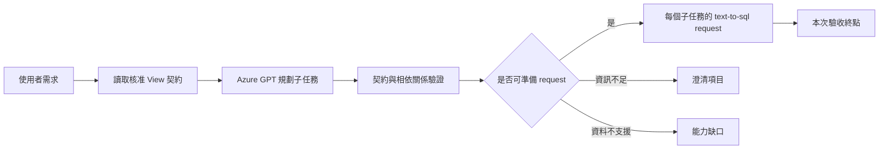

# Retail 前置需求拆分與 benchmark 規格

## 目的與已確認需求

在既有單 View text-to-sql 之前新增獨立資料分工決策層，從使用者需求與核准 View 契約決定必要來源、子查詢及整合方式。本次使用 Retail 契約與 Azure GPT，只驗收到可提交的 text-to-sql requests，不生成 SQL、不連線查詢 DB，也不依尚未取得的資料產生採購結論。

使用者已確認採獨立前置 planner 方案、要求先建立 30 個跨表需求，並指定從專案根目錄 `./.env` 取得 Azure 連線資訊。這份文件將已確認方向具體化，尚待書面規格確認；目前沒有實作產品程式。

## 現況與邊界

- 既有 `SQLGenerationWorkflow` 維持單 View SQL 編譯；其多來源拒絕行為是目前契約，不當成 bug 修改。
- Retail 目前有 7 個核准 View。`v_inventory_status` 已含近 30 日銷量，因此 planner 應選足夠且必要的來源，而非一律把採購需求拆成兩份。
- 第一版獨立規劃入口不自動插入既有網頁、SQL API 或執行流程；後續可由上層先呼叫 planner，再明確 dispatch。驗收只到 request 準備，不能宣稱下游已遵循規劃來源。
- 第一版不引入 DB adapter、embedding、向量檢索、持久化對話或新的 agent framework。使用專案既有 Pydantic、LangChain 模型介面與 LangGraph。

## 流程

圖中 C 與 D 是獨立規劃 workflow 的節點；本階段不呼叫既有 SQL 生成 workflow。規劃服務接受 `request: str`，回傳結構化計畫，並可透過注入 fake LLM 驗證純規劃行為。

## 模型可用資訊

第一版將目前 Retail 全部 7 個核准 View 的名稱、摘要、欄位型別與語意、粒度及聚合限制交給模型。benchmark 預期答案、案例 ID、審核 metadata 與評分規則不進入模型訊息。

使用既有 context/token 設定，在完整 prompt、契約與 response schema 超過輸入預算時明確回報 `context_budget_exceeded`，不靜默截斷契約、增大設定或退回另一模型。模型只呼叫一次；解析或驗證失敗保存原因，不自動重跑。

## 計畫契約

頂層狀態：

- `ready`：所有必要資料有來源，子任務與整合計畫已通過結構及契約驗證，可以準備 request。
- `needs_clarification`：缺少足以決定查詢範圍或精確決策的條件，回傳明確澄清項目。
- `unsupported`：核准 Views 無法支持必要資料，回傳缺少的資料能力。
- `error`：格式、契約、context 或 provider 失敗，回傳固定錯誤碼，不把原始 key、endpoint 或例外直接輸出。

`ready` 計畫含 `strategy`（`single_view` 或 `multi_view`）、子任務與整合描述。其他狀態不得提供可 dispatch 的 requests；不得因部分資料可取得就把不完整需求標為 ready。

每個子任務包含：

| 欄位 | 要求 |
|---|---|
| `task_id` | 同一計畫內唯一且非空。 |
| `view` | 只指定一個核准 View。 |
| `required_columns` | 包含輸出、條件、分組、聚合、排序及合併鍵所需的欄位。 |
| `filters` | 結構化 column/operator/value；保留原始期間及業務條件，不能跨錯來源。 |
| `metrics`、`group_by` | 描述聚合及目標粒度，遵守欄位的允許能力與禁止聚合。 |
| `output_grain` | 清楚指定輸出單位；聚合前的明細不能當作已對齊資料。 |
| `depends_on` | 引用已存在子任務，禁止自我相依與循環。無資料相依的查詢標為可平行準備。 |
| `request` | 清楚且自足的自然語言查詢，明列來源、必要欄位、條件、聚合與粒度；不能要求 text-to-sql 同時查兩個 View。 |

應用層只在計畫通過驗證後，從每個子任務產生符合既有介面的 `{ "request": "…", "history": [] }` payload。View 與欄位 metadata 另外保留，供後續受約束 dispatch 驗證；metadata 不冒充既有 SQL API 已支援的參數。

request 本身不包含 SQL。只要仍依賴未取得的上一子任務結果，必須標明待綁定輸入，不能把 placeholder 當成可立即提交的 payload。本次 30 題皆可平行取數，再於之後整合；不需要動態 ID 集合才能準備查詢。

## 整合計畫

整合計畫指定來源 task、左右兩側鍵、整合模式、整合前彙總／巢狀收集／月份展開，以及最終輸出粒度。三來源案例逐邊描述，不能把商品鍵套用到門市 KPI。

- 只有鍵名相同不足以保證可合併，需核對語意、型別與輸出粒度。
- 庫存、月報及交易期間各自保留；目前庫存不能解釋為指定歷史月份的庫存。
- 門市 KPI 若附到商品資料，只能作門市背景；不得按商品列重複加總目標、營收或比例。
- 一對多輸出採先彙總、展開或收集子集合的方式，避免重複計算庫存、會員累計消費或門市目標。
- `city` 必須區別會員註冊城市與門市城市，不能因字樣相同就互換。
- 會員母體、門市母體及庫存商品母體依題意保留。未匹配資料標記缺值；契約未保證時不可假設為零。
- 庫存快照日期作時間 metadata；彙總到門市／區域時可保留日期集合，不把日期當成可加總量。
- 規劃目標可描述採購優先評估所需資料，不虛構供應商交期、在途採購、補貨政策、預算或精確採購量。

## benchmark 題庫

專用題庫為 `projects/retail/evaluations/task_decomposition_cases.jsonl`，閱讀矩陣為同目錄 `task_decomposition_matrix.md`。保持既有 `cases.jsonl` 與 SQL benchmark 不變。

題庫固定 30 題，28 題兩來源、2 題三來源，涵蓋全部 7 個現有 View。題目使用明確的 2026 年月份／日期，不依系統當日變動；目前庫存仍依契約表示目前快照。

每題記錄需求、主要預期子任務、必要欄位、filters、聚合、粒度、整合鍵、先處理步驟與注意事項，並保存 profile、契約及案例指紋。另列已知可接受的等價來源與欄位對應，避免將合法替代查法誤判。

所有新案例初始為 `review_status=pending`。自動結構檢查通過不代表人工審核通過；人工核准需連結目前案例與契約指紋。原則為選最少且足夠的來源，不以每個 View 兩兩組合硬湊需求。

30 題是使用者指定的跨來源需求集；避免過度拆分的單來源控制組、澄清、不支援與惡意輸入保留於合成的離線單元測試，不灌入這 30 題。

## 評分與產物

先執行一輪 30 題觀察基準，需觀察穩定性時再用相同設定跑三輪。每次 LLM 呼叫都列入預算；不做 warmup、解析重試或隱藏的答案生成。

逐題評分包含：

1. 狀態與來源策略正確。
2. canonical View 集合命中，以及另列的等價方案正確率。
3. 按 View／任務語意配對後，必要欄位覆蓋及非法欄位數；不能按子任務陣列位置比較。
4. filters、聚合、粒度及整合鍵保留；動作描述不能只因字串不同就判錯。
5. requests 是否可以完整且獨立提交；沒有提前生成 SQL 或呼叫 DB。

自動可確定的 View／欄位／結構評分與需要人工判讀的 request／整合語意分開。不能以純字串比對宣稱自然語言 request 語意完全正確；未涵蓋的新替代方案列入人工審核。

產物保存於 `projects/retail/artifacts/task_decomposition/<run-id>/`，包含非機密設定與 Git／diff、prompt、schema、契約、題庫指紋，逐題解析結果、驗證錯誤、評分、token 用量、耗時、完成及略過狀態，另輸出繁體中文摘要。原始 prompt／response 存放於受忽略的私有產物，不混入公開摘要。

未核准題庫執行結果明確標為探索性。未完成與略過的案例不提高正確率；三輪穩定性只針對三輪皆完成的案例，另列一致失敗，不把一致性視為正確性。

## Azure 設定

使用根目錄 `./.env` 的 `CPEA_AZURE_LLM_BASE_URL` 與 `CPEA_AZURE_LLM_API_KEY`，在 runner 中明確選 Azure，不能沿用目前 `ASSISTANT_LLM_PROVIDER=ollama` 或 `ASSISTANT_LLM_MODEL=qwen3.8:27b`。不改寫使用者 `.env`。

Azure GPT deployment 由明確 CLI 參數提供，不從 Ollama 模型名稱推定。已確認 endpoint、key 及 `langchain_openai` 套件存在；本環境 endpoint 未含 deployment 名稱，需使用者提供實際 Azure GPT deployment 才能開始 live benchmark。endpoint URL 依實際 Azure 介面解析，實作前核對 SDK 用法，不臆測服務路由。

任何 provider SDK retry 設為 0。遇 rate limit 不重跑；保存私有 terminal output，依使用者規則交 `quota.py inspect-terminal` 判讀，不將 Azure 問題誤當作 Codex 帳號額度。若判讀為 quota/auth/network 問題，依結構化狀態停止後續呼叫並記錄未完成題。

## 驗證與後續

- 離線驗證：合法多來源、單來源控制、未知 View／欄位、不合法聚合、遺失鍵、未知／循環相依、非 ready 仍帶 payload、context 超限、無資料的決策問題。
- 題庫驗證：30 個唯一案例、至少兩個必要來源、全部 7 個 View 有覆蓋、主要及替代欄位／聚合合法、題庫及契約指紋一致。
- 回歸：既有單 View、語意確認、API 與 project evaluation 契約。
- Azure 實測：只呼叫 planner，不依賴 DB 設定；保存成功和失敗結果，報告實際正確率，不預先承諾滿分。
- 獨立驗收：實作後另作 fresh review 與負面案例驗證，不由建立答案的同一段程式自證通過。

本次不實作 SQL dispatch、跨 View SQL、執行與資料合併、採購數量演算法、UI 重構或其他資料庫支援。書面規格確認後再建立可執行的實作計畫，並在現有 OpenSpec 流程登記這項架構變更。
