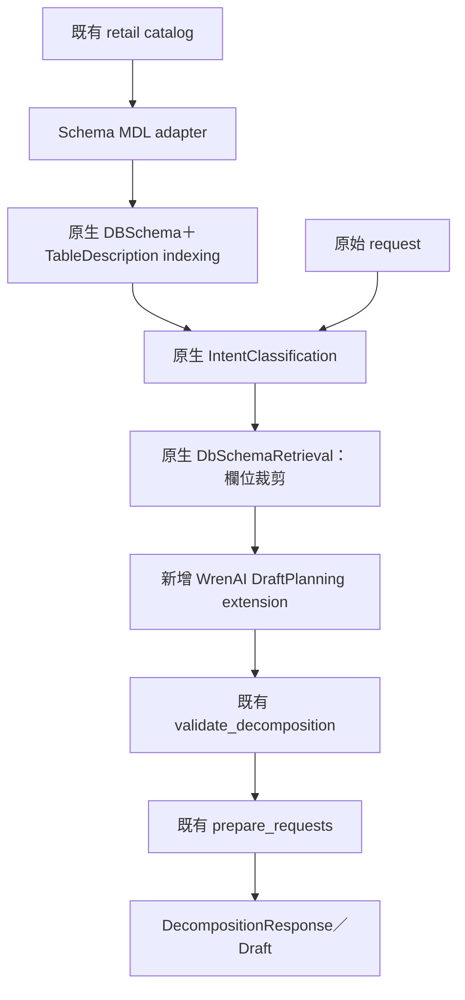

# WrenAI 需求理解與欄位彙總獨立流程設計

狀態：**已核准離線開發；已整合 RAG／工程審查 F1–F7 的 A 方案。本文是規格，不代表安裝或測試已完成；真模型／正式題庫另待資源。**
日期：2026-10-23。研究基準：CPEA `ab4c67a45fa7039379bcadd788af0ae83bb3630f`。

## 使用者已決定的範圍

- 保留 `workflow.py` 單呼叫流程與 `schema_mapping_workflow.py`，另建獨立流程。
- 新流程以真實 WrenAI 為主；先測試，再決定是否需要混合架構。
- 輸出既有 `DecompositionDraft`，交給後續 SQL generation；本階段不生成或執行 SQL。
- 第一階段需求直接使用 DB 欄位名稱；不建立 MDL 業務詞典、同義詞或 memory。
- 使用 `projects/retail` sample；每個模型呼叫節點保存 req、res、耗時、tokens、費用與 oracle 測試。
- 正式測試題庫由使用者另外準備；本次只建立必要的離線契約／錯誤情境 fixture 及正式題庫載入介面，不代建正式 benchmark 題庫。

使用者於 2026-10-23 已授權依本設計整合審查後開始開發；採下列 pinned 版本、隔離方式及七項 A 方案。範例測例數量仍是資源估算，不是正式題庫或真模型授權。

## 上游版本及真實重用邊界

採 WrenAI `legacy/v1` commit `ce9ed54c86acb8a0b6ff5d5fea23ed60f057acfc`，其 AI service 版本為 `0.29.3`。
[官方原始碼](https://github.com/Canner/WrenAI/tree/ce9ed54c86acb8a0b6ff5d5fea23ed60f057acfc/wren-ai-service)。

此版本最貼近本需求：真實 pipeline 以 Hamilton `AsyncDriver` 執行，採 Haystack `Document`、`PromptBuilder`、document writer，透過 provider 介面接模型、embedding 與 document store。直接載入並執行以下 upstream 類別，不能以本地模仿取代：

| 類別／元件 | 本流程用途 |
| --- | --- |
| `indexing.db_schema.DBSchema`、`DDLChunker` | schema MDL 轉成欄位分批文件並索引 |
| `indexing.table_description.TableDescription` | table/model 名稱與欄位清單索引 |
| `generation.intent_classification.IntentClassification` | schema-grounded 意圖分類與問題重述 |
| `retrieval.db_schema_retrieval.DbSchemaRetrieval` | 表候選、完整 schema 取回、LLM 欄位裁剪 |
| `providers.llm.litellm.LitellmLLMProvider` | 原生模型生成 provider |
| `providers.embedder.litellm.LitellmEmbedderProvider` | 原生 query／document embedding provider |
| `providers.document_store.qdrant.QdrantProvider` | 原生兩類 schema 文件 store／retriever |
| `core.pipeline.BasicPipeline`、Hamilton、Haystack `PromptBuilder` | 新增 Draft 輸出 extension 的原生執行框架 |

WrenAI upstream 沒有 `DecompositionDraft` 輸出。唯一新增的語意生成 extension 是 WrenAI `BasicPipeline` 中的 `DraftPlanning`：使用 upstream LLM provider、Haystack prompt 與 Hamilton DAG，把 WrenAI 選出的 schema／欄位及原需求轉成既有 Draft。這是明示的 CPEA 輸出契約 extension；不重用 LangGraph planner、不呼叫既有 schema-mapping 規劃器，也不偷偷 fallback。

截至查證，官方 main `f618d8d9848c3d6b617859e575bd560d50bcc04e` 已改成 CLI/core 與 framework toolkit；`wren-langchain 0.2.3` 無 memory 時只提供 query、dry-plan、dry-run，缺少本需求可直接接用的 pre-SQL 理解 pipeline，故本次建議 v1。
[現行架構](https://github.com/Canner/WrenAI/blob/f618d8d9848c3d6b617859e575bd560d50bcc04e/docs/core/reference/architecture.md)、[toolkit](https://github.com/Canner/WrenAI/blob/f618d8d9848c3d6b617859e575bd560d50bcc04e/sdk/wren-langchain/src/wren_langchain/_toolkit.py)。

## 方案比較

1. **本草案採用：真實 WrenAI v1 upstream＋隔離 worker。** 原生 intent／retrieval／indexing 符合 pre-SQL 邊界，新增 WrenAI Draft extension 承接 CPEA 輸出；代價是獨立環境、schema index 與窄維護 patch。
2. **現行 main toolkit。** 維護路線較新，但無 memory 時只有 SQL 執行／dry-plan／dry-run，缺少本次所需的 pre-SQL 理解原語，因此本階段不採。
3. **本地重建／Hamilton-only。** 依賴可能較少，但沒有實際重用 WrenAI pipeline，不符合使用者先以 WrenAI 為主的決定；僅在原生測量後另評估混合，不在本次偷偷替代。

## 執行與依賴隔離

採 pinned upstream checkout＋獨立 Python 3.12 環境的常駐 worker；CPEA 透過有版本的 JSON lines 協定呼叫，單次 `plan(request)` 對應單一 run。父程序只負責 catalog adapter、程序通訊、既有驗證與輸出包裝。這是依賴隔離，不是混合語意規劃。

必要原因：upstream `package-mode=false`，不是可直接安裝的穩定 Python SDK；其 `numpy ^1.26.4`、`tiktoken ^0.12.0` 與 CPEA 的 `numpy>=2.4`、`tiktoken>=0.14` 不相容。保留 upstream 來源 SHA、套件 lock、Python 版本、import source 路徑與窄 patch SHA，不變更既有 CPEA 環境。
[上游依賴](https://github.com/Canner/WrenAI/blob/ce9ed54c86acb8a0b6ff5d5fea23ed60f057acfc/wren-ai-service/pyproject.toml)。

worker 的 stdout 僅輸出協定事件，upstream logging 走 stderr。定義 startup handshake、request/run ID、terminal result、worker error、timeout、取消與正常關閉；父程序遇 crash／錯誤回 `error` 並保留既有紀錄。序列處理 MVP，避免跨 request trace 汙染。worker 不接 DB 連線，不實例化／呼叫 SQL Engine，也不載入舊 planner。upstream intent 的 utils.sql 會傳遞 import src.core.engine，因此允許載入型別／模組及其必要依賴；不能以 module 零 import 作驗收。Qdrant 使用此流程專用 collection，不清除共用 index。

upstream AI service 標示 `AGPL-3.0`；保存來源與授權，不將 legacy service 誤認為現行 core 的授權。未研究部署／散布情境；本次限定本地研究及實驗。

## 最小 catalog／schema MDL

「不建立 MDL 業務詞典」仍需結構性 schema payload，因原生索引 pipeline 的入口是 MDL JSON。這是從既有 catalog 自動產生的衍生物，不新增人工語意來源。

- 每個已核准 SQL View 轉為一個 MDL `model`；不把它轉成 MDL `view`，後者是 SQL statement 物件，無相同的欄位索引結構。
- 每個 model 包含名稱、原有欄位名及標準型別；`relationships=[]`、`views=[]`、`metrics=[]`。`properties` 可為空。
- 使用穩定、可逆且碰撞檢查的 model-name→qualified-view mapping，不能把不同 schema 同名 View 合併。
- `number`→`NUMERIC`、`string`→`VARCHAR`、`date`→`DATE`、`boolean`→`BOOLEAN`；保留原型別供 CPEA validator 使用。
- 不捏造唯一鍵。upstream `primaryKey` 只有單欄形式；本案複合粒度仍保留在原始 contract，不能截取一欄假稱 primary key。
- contract 的 capabilities、aggregations、grain、scope、time、禁止操作及缺值政策，透過 DraftPlanning 的唯讀契約 context 與最後 deterministic validator 保留，不改寫成 business dictionary。
- index namespace／manifest 包含 catalog fingerprint、schema adapter 版本、upstream SHA、embedding model／dimension；不相容則重建此流程自己的 index。
- 只有 schema 索引；不索引歷史問題、SQL pairs、instructions、術語詞典或 memory。retail 七個 View 的描述與限制已存在，避免再生成一份詞典。

## 已採納的審查修訂與可執行邊界

依 [RAG／工程審查](../../../evidence-driven-dev/tasks/wrenai-semantic-decomposition/rag-eng-review.md) 採 F1–F7 的 A 方案；不增加第二套語意 planner。實作檔案、固定介面與 TDD 分工見 [開發計畫](../plans/2026-10-23-wrenai-semantic-decomposition.md)。

| Finding／採用 | 實作契約 | 驗收證據 |
| --- | --- | --- |
| F1／1A | `NamespaceQdrantProvider` 是原生 `QdrantProvider` 的窄 subclass；建構前固定 namespace，覆寫 `get_store` 將**全部六個** logical dataset（含預設 `Document`）映射成實體 collection，維持原生 store／retriever。明確傳 `recreate_index=False`，禁止從環境繼承強制 recreate；namespace 含 manifest identity／embedding dimension。 | 盤點 constructor 觸及的全部 collection；真本機 Qdrant 上兩 namespace／不同 dimension 互不影響，共用 sentinel 不變。不能只在 kwargs 填 namespace。 |
| F2／2A | 原生 `filter_columns_in_tables` 之後、`construct_retrieval_results` renderer 之前執行 deterministic selection boundary。拒絕未知 table／column、重複 table／column、空 results／columns；空候選獨立回 `needs_clarification`，不把空 columns 當全欄。保存 raw selection、model mapping、rendered DDL；不補模型漏選來源。 | 用真 renderer 驗 empty、unknown-only、known+unknown、duplicate、unknown table；拒絕後 Draft transport=0。合法 grain／integration 輔助鍵與 filter-only 欄位分開度量。 |
| F3／3A | 每個 generation 以 manifest `building → ready / failed` 管理；同 namespace writer 使用本機排他檔案鎖，非空 project_id 必填。兩個索引 documents／count／content digest 都核對後才原子發布 ready。讀者先檢查 ready；crash 留 building 時只可重建本流程自己的 generation。 | 第二 store 前／中途失敗、重啟、競爭 writer、空 project_id、假 digest；都不能讀半成品或清共用 collection。MVP 不做藍綠或新交易服務。 |
| F4／4A | 在 LiteLLM completion／embedding transport 前後錄製，每一 batch attempt 有 call_id／batch_id，raw response 先落盤再 finish-check／JSON extraction；retry、SDK retry、Router fallback 全固定關閉。embedding 同時在途上限預設 1，batch size 保持 upstream 32，失敗後取消並等待全部已啟動任務落終態。 | leading/trailing text、length finish、usage missing、Azure deployment≠SKU、兩 batch／部分失敗／取消；attempt ledger 一一對帳，未知 usage／費用不填 0。 |
| F5／5A | JSONL v1 使用 accepted／running／terminal；取消後有 cancel_requested／cancelled／unknown_outcome。每 run 恰一 terminal，late event 按原 run/call ID 封存。timeout 後 grace→terminate→kill→reap，完成排空或重啟才接下一 run。stdout／stderr 同時 drain，stdin write 後 drain，限制 line／payload／queue。 | 大量 stderr、非法／超大 stdout、EOF、crash、late terminal、兩 run 順序及 shutdown/reap；已發送但無 response 的 attempt 標 unknown_outcome，禁止自動重送。 |
| F6／6A | 零真模型階段使用**完整 pinned upstream＋專用本機 Qdrant**，只替換 LLM／embedding transport；test store 單測不能代替整體整合。沿用 task-equivalence grader，額外 Oracle 必須拒絕 extra measure、錯母體、跨來源 filter 錯置、錯缺值政策。 | 真 retail 7 Views／102 欄位來自 catalog；自然 native index→intent→retrieval→Draft→既有驗證，不以金答案替換 retrieval。Oracle mutation 必須能把原本 PASS 變 FAIL。 |
| F7／7A | intent／pruning／Draft 各以實際 rendered system/user/response_schema 計 token；使用明確 model context、output reserve、safety，設定實際 output max tokens。transport 前超窗回明確 error，不截 request／契約；該拒絕節點 transport=0，run 既有 attempts 仍如實保存。 | 三節點臨界值、response schema 計數、非 OpenAI tokenizer、輸出 reserve、完整 scope/time；length／截斷 JSON 保存 raw 後 error。估算 token 與 provider usage 分開。 |

worker 協定與檔案限制固定為 protocol v1、單行最多 4 MiB、單一 plan payload 最多 2 MiB、事件 queue 最多 128；超限拒絕並記 `protocol_limit_exceeded`。預設 run timeout 120 秒、cancel grace 2 秒、terminate grace 2 秒，可由顯式設定調整並記入 run manifest；這是生命週期上限，不代表 latency SLO。stdout 只允許協定，stderr 逐塊排空到私有 artifact；不可只等 `process.wait()`。

`project_id` 固定取完整 generation fingerprint，不允許空值。manifest identity 至少含 catalog fingerprint、adapter version、upstream SHA、patch SHA、lock hash、embedding provider/model/dimension；建立後補兩類 documents count/content digest。namespace 使用 `cpea_wrenai_<identity前24碼>_<dataset>`，同 generation 寫入鎖含完整 identity 以防截斷碰撞；metadata 不符拒用而非覆蓋。

worker 回傳 Draft JSON，由父程序使用唯一既有 `DecompositionDraft` 模型解析，不在隔離環境複製 CPEA Pydantic model。父端送既有 response JSON schema、原始 request、選源前完整唯讀 contract；DraftPlanning 只取**所選 View**的完整 grain/scope/time/usage/column capability 與 integration 所需 keys。expected_tasks／Oracle／可接受答案不得進協定 plan payload。

GENERAL／USER_GUIDE 對應 `unsupported`；MISLEADING_QUERY 對應 `needs_clarification`。原生 parser fallback、未知 enum、JSON／provider 錯誤對應 `error`；不把無效分類當 TEXT_TO_SQL。以原生 `post_process` 與 `construct_retrieval_results` final-node 值解包，不傳整個 Hamilton 回傳 dict 到 Draft。

## 節點與控制流

| 節點 | 入口／出口 | 模型與失敗政策 |
| --- | --- | --- |
| `schema_index` | schema MDL→兩類索引文件 | document embedding，按 batch 計呼叫；相同 manifest 可重用 index |
| `intent` | 原始需求、空 histories→原生 classification result | upstream 1 次 LLM，另有 query embedding；保留原始需求，禁止重述覆蓋條件 |
| `schema_retrieval` | 原始需求→retrieval_results | upstream query embedding；`enable_column_pruning=True`，正常 1 次欄位選擇 LLM |
| `draft_planning` | 原始需求、intent、選定 schema、契約→Draft | Wren provider 1 次 LLM；產生單／多 View tasks、filters、metrics、grain、integration |
| `validate`／`prepare` | Draft→既有 Response | 零模型，重用現有 validator 及 request 準備；失敗不派 SQL |

正常成功路徑約三次 LLM，加兩次 query embedding；索引 embedding 另計，不把 embedding 或 skipped nodes 隱藏在「三次」裡。實際 transport attempt 數才是成本／額度計量依據。

原生 intent `post_process` 解析失敗會 fallback 成 `TEXT_TO_SQL`。本流程必須在 provider／parser boundary 核對原始輸出 schema，保留原始錯誤，不能把 fallback 當有效分類。明確的 GENERAL／MISLEADING／USER_GUIDE 以清楚政策回 needs_clarification 或 unsupported；provider／parse 失敗回 error。

原生欄位裁剪輸出未證明所有需求被保留。runtime 的既有 `validate_decomposition(draft,catalog)` 只能檢查欄位、能力、型別、grain 與 integration 等結構契約；它不收原始 request，無法保證條件／母體未遺漏。DraftPlanning prompt 必須要求保留原條件、原 identifier，僅可加入原契約允許且必要的 grain／integration keys；這是生成約束，不等同正確性證明。

每個已知測例由 evaluator 的獨立 oracle 核對必要 identifier、filters、期間、母體保留、禁止操作及輔助鍵，並把差異寫到對應 node 的 oracle result；runtime 面對任意新需求沒有完整語意 coverage 保證。只驗欄位合法不能判為語意 PASS。這裡不新增第二套語意 planner 或模型 reviewer。若自然 retrieval 漏掉必要欄位／Draft 遺漏條件，evaluator 記錄 FAIL，回研究者判斷；不自動 fallback。

## req／res／tokens／耗時／費用

每次 LLM 與 embedding 真正呼叫，產生唯一 `call_id`，連結 `run_id`、`case_id`、`node_id`、`attempt`、上游父事件與 payload fingerprint。preflight 失敗也記錄 node event，但 `model_calls=0`。

每個 call 保存：實際送出的安全 request（system/user、response schema、generation 設定；不含 auth headers／credentials）、原始 response、安全 provider metadata、解析後物件或解析錯誤、開始／結束時間、`elapsed_ms`、provider／實際 model、input/output/total tokens、usage 原始值與正規化來源、error code。

`spend` 同時呈現耗時與貨幣費用，避免字義混淆。費用欄位包含 `currency`、`amount`、`pricing_version`、`pricing_source`、`status`（reported／estimated／unknown）。未提供價目或模型版本不明時為 unknown；不可用 0 冒充。Azure deployment 名不能直接當作模型 SKU。索引、查詢 embedding、LLM 分開加總；有 unknown 時保留完整性標記。

raw req/res 存本地 private artifact（檔案 0600／目錄 0700），公開 summary 只放 counts／status／codes／fingerprints。每個節點完成或出錯立即 flush，完整保存第一個失敗。

原生 LiteLLM provider／embedder 使用 `backoff max_tries=3`。需要獨立可 review 的窄 policy patch，使實驗可設定 **transport attempts=1**，並關閉 LiteLLM／SDK 內層 retry；不得只在 runner metadata 寫 `sdk_retries=0`。rate limit 保存 terminal 後依本 repo quota.py 規範處理，不能先 retry。這個 patch 屬執行政策，不更換 WrenAI 語意 pipeline。

Langfuse `trace_cost` 只傳 model／usage metadata，不會自動提供本任務需要的本地 oracle 或完整 pricing provenance；不能以已有 decorator 代替上述 artifact。

## Oracle、離線 replay 與驗收

oracle 只由 evaluator 讀取，不送給 planner。每個 node fixture 包含 case／node ID、固定輸入、預期的必要欄位／條件／狀態、不允許行為、可接受替代集合、catalog／prompt／schema／source SHA 與審核狀態。自由文字理由不做字串精確比對，不要求模型提供私有推理。

| 節點 | Oracle 的實質內容 |
| --- | --- |
| schema adapter／index | 七個 View／欄位／型別完整、名稱可逆、無 fake PK、無術語／memory；project index 隔離 |
| intent | TEXT_TO_SQL 類別；原日期、欄位、值、否定條件與保留母體不被重述刪除 |
| retrieval／pruning | 所有必要來源可接受集合、每個來源必要欄位 recall、額外欄位 precision；join／grain 輔助欄位另列 |
| DraftPlanning | 既有 task-equivalence grading 加 filters、conditional_metrics、metadata、grain、anchor／preserve／cardinality／missing-data 不變量 |
| validate／prepare | 既有 validator 無錯誤；ready 才有 payload；request/history 與 task/view 一致 |
| trace／retry | 每個 transport attempt 一筆，usage unknown 不造零，provider／parse／timeout／worker crash 均可定位，rate limit 不重跑 |

提供兩種明確離線模式：`regrade` 只重評儲存的輸出，零模型；`replay` 使用錄製 provider response 重跑指定 node 或完整 worker graph，零網路模型。replay 同時注入 completion、document/query embedding responses 與匹配的 index snapshot／manifest。檢查輸入／catalog／schema／upstream／patch／lock／Python／model／tokenizer／prompt／index identity；原版本不符要拒絕或明標 drift，不能聲稱精確重現。單節點可用核准 upstream fixture 隔離測試，整體測試則必須使用自然上游輸出，不能以金答案覆蓋 retrieval 結果。

## MVP 分階段與回到父流程的門檻

1. **環境／契約 spike，零付費**：獨立環境能載入真實 pinned 類別；來源 handshake 正確；schema adapter→原生兩類 indexing→專用本機 Qdrant 能保留七個 View／102 欄位；fake transport 仍使用真 store／retriever、兩個 namespace 與 generation manifest。worker JSON、timeout、錯誤、retry policy 可測。證據回到整體 worker 呼叫。此階段未證明語意能力。
2. **離線 node 與整體契約**：可控 provider fixture 覆蓋成功、非 ready、無候選、無效 JSON、unknown column、漏 filter、錯 grain、provider 失敗／rate limit。逐節點 trace 與 oracle 全部可定位；整體 Draft 通過既有 validate／prepare。保留兩條舊 flow 的 focused regression。
3. **最小真實 smoke，題庫／資源待確認**：從使用者提供的正式題庫挑選最小代表集合，每題 1 run；可建議 4 個正向樣本＋2 個拒絕／澄清樣本作規模參考，若採六題則最高 18 次 LLM attempts，加 embedding。實際案例、呼叫上限及 Oracle 以使用者題庫與核准資源為準，不自行把下列例子升格正式測例。使用明確 provider／model、embedding model、索引及總額度。沒有價目時貨幣 spend 仍標 unknown；未授權不先呼叫。停止於 rate limit／provider error，保留之前結果。
4. **自然整體比較**：上述語意 smoke 正確後，擴至含單／雙／三 View、條件計數、日期集合、背景附加與同名欄位歧義的案例；比較三條 flow 的品質、latency、tokens、已知費用與 unknown 比例。基準同輸入／契約／驗收；失敗先依節點證據重判，再決定是否混合。

以下六個 sample 僅說明 identifier 與契約可表達範圍，不是正式題庫；正式題庫由使用者另行提供：

- 單 View：列各 `customer_id` 的 `registered_on`、`lifetime_spend`，包含未下單會員。
- 彙總：`v_sales_detail` 在指定 `order_date` 區間，按 `store_id`、`product_id` 計 `SUM(quantity)`；不把明細列數當訂單數。
- 雙 View：`v_inventory_status` 的 `stock_qty` 與 `v_product_monthly` 在 `sales_month=2026-09-01` 的 `units_sold`，按 `store_id/product_id`，保留全部庫存商品。
- 三 View：上例加入 `v_store_monthly_kpi.target_amount`，同月門市目標僅依 `store_id` 附加；不可沿商品重複加總。
- 拒絕：要求不存在的 `missing_metric_xyz`，不能擅換 `gross_profit`。
- 澄清：只說依 `city` 分析而未指定會員居住城市或門市城市，不能猜母體。

上述欄位已以 raw YAML 與本 checkout 的 `SchemaCatalog.field_contract` 機械核對：均存在、`quantity` 的 SUM 合法、`missing_metric_xyz` 在七個 View 都不存在；庫存 grain 為 store_id/product_id，月商品 grain 另含 sales_month，KPI grain 為 store_id/sales_month。語意 sample 仍為建議，尚未人工核准 oracle。既有 30 題 decomposition oracle 全部 pending，且多數使用業務中文詞；本次實測 catalog fingerprint 為 `f448fd223570b38ab5cd4002a5afc31b60002422cd47549868c64cbf2c87c430`，兩個既有 casefile 仍 pin `e5e5a5…`，另有 fingerprint drift。不能原樣直接當成這一階段正式 benchmark；可借用其結構與等價規則，另建明確 identifier 題庫並保留原題庫。

完成主張必須同時包含真實 WrenAI import／來源證據、逐 node 檢查、自然 end-to-end Draft、舊 flow regression；若僅離線 fixture 通過，報告必須明說真模型能力未驗證。

## 權衡及後續資源

建議優先真實 v1 upstream 的可識別重用及測量，代價是獨立環境、Qdrant、embedding 與窄維護 patch。沒有把所有原生 SQL 生成／Engine 引入前置需求拆解邊界；後續 SQL 仍沿用 CPEA 契約。

legacy/v1、結構性 MDL adapter 與隔離 worker 已獲離線開發授權。真實測試前另需使用者提供正式題庫，並指定 LLM／embedding provider、model、可用 Qdrant 與總呼叫／費用預算；目前費用 unknown。正式題庫尚未到位不妨礙先完成離線契約驗證及評估載入介面。本規格不預告環境安裝、離線實作或測試成功；完成狀態以開發計畫及 EDD evidence 為準。混合語意架構留待原生節點測量結果顯示必要時才提案。
