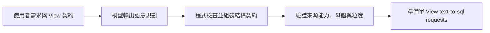

# DeepSeek 分階段規劃調查結果

目前不建議把既有 planner 直接改成多次 LLM 呼叫。十題成對實驗中，原版自動結構通過 7/10，單次加入檢查步驟與三階段版本都是 2/10。這個具體拆分方案沒有達到預先設定的改善條件，且有原成功控制退步。結果只適用於本次策略與樣本，不能推論所有分階段設計都無效。

建議優先把欄位角色、來源能力與粒度約束做成可檢查的中間契約，再研究是否需要增加模型階段；這是後續候選方向，尚未驗證改善，也未改動產品流程。

## GPT 能提供的參考

既有 GPT 紀錄沒有內部 reasoning trace，只有最終規劃 JSON、模型輸入、usage 與耗時。本次參考的是可觀察決策，不聲稱取得或重建 GPT 內部推理。

| 決策責任 | GPT 最終輸出的可觀察做法 | 原 DeepSeek 對應失敗 |
|---|---|---|
| 來源覆蓋 | 需要通路條件就選含 sales_channel 的明細來源 | 11、29 選不含通路的商品月表，卻聲稱查到線上銷售 |
| 單 View 欄位角色 | 逐筆日期用 attributes；彙總來源日期用 metadata_collections | 10、16 的日期集合／分組與輸出粒度不一致 |
| 母體保留 | 14 用條件計數保留零缺貨門市 | 14 先 filter stock_qty=0，刪掉零缺貨門市 |
| 整合粒度 | 24 門市為母體，各分類收成以 store_id 對齊的子集合 | 最終粒度與 nest keys 混入分類維度 |
| 指標與條件 | 26 用來源 order_id 計數，明列使用者指定通路篩選 | 幻造 order_count 來源欄位、漏通路 filters |
| 既有旗標 | 21 直接讀 active_in_last_90d | 要求重新定義非需求中的計算政策 |

現有 LangGraph 雖有 load_contracts、plan_tasks、validate_plan、prepare_requests 四個節點，只有 plan_tasks 呼叫模型；來源、查詢任務與整合都在同一回覆完成。具體輸出違約已確認，但一次負擔太多責任是競爭假設，不能直接當作根因。

## 預先固定的比較

- 只呼叫 Azure DeepSeek-V4.1-Flash；GPT 僅作既有輸出參考，不使用 Ollama。
- 十題：02、07、18 為原成功控制；11、14、16、21、24、26、29 為診斷案例。全部是已見的原題庫，沒有新外部 holdout。
- A：原 prompt v3，一次完成。
- B：原 prompt 加通用檢查步驟，一次完成。
- C：與 B 相同規則，分為需求／來源路由、每 View 獨立子任務、整合。路由的來源與粒度固定；單 View 契約失敗即停止該題，沒有自動修補。
- 三 arm 執行順序逐題輪替；共同使用 temperature=1、top_p=1、seed=42、context_window=16384、max_output_tokens=-1、timeout=300 秒、SDK retries=0、JSON object。
- 模型輸入沒有測試題號、oracle、expected_tasks 或 GPT 答案。產品 prompt、契約、題庫與 grader 均未修改。

成功標準預先定為 C 自動結構分數高於 B，且三個原成功控制不退步；本次未達成。C 同時改變 schema、上下文範圍與呼叫數，屬整體策略比較，不能隔離歸因為呼叫次數本身。

## 實測結果

| 指標 | A 原版 | B 單次檢查步驟 | C 三階段 |
|---|---:|---:|---:|
| 完成案例 | 10/10 | 10/10 | 10/10 |
| 來源與必要欄位原評分 | 9/10 | 4/10 | 6/10 |
| Request 結構就緒 | 7/10 | 5/10 | 5/10 |
| 完整結構自動通過 | 7/10 | 2/10 | 2/10 |
| 三個成功控制自動通過 | 3/3 | 2/3 | 1/3 |
| 實際模型呼叫 | 10 | 10 | 37 |
| 輸入 tokens | 74,663 | 78,103 | 161,045 |
| 輸出 tokens | 8,744 | 7,466 | 10,839 |
| 累計模型呼叫耗時 | 91.8 秒 | 70.1 秒 | 130.8 秒 |

合計 57 次實際 Azure 呼叫，provider 失敗 0；實驗約五分鐘完成。B 有一題產出不合法 cardinality enum，是模型格式錯誤，不是 provider 錯誤。C 總 tokens 約為 A 的 2.06 倍，呼叫數為 3.7 倍；沒有取得計費單價，不推算金額。耗時是同場觀測，未控制快取與服務負載。

原 DeepSeek 在這十題只有 3 題自動通過，本次相同原 prompt 重跑為 7 題；顯示跨次結果不同。單次舊分數不能當成固定能力基線，模型非確定性或服務環境變因仍未排除。GPT 原完整首輪仍為 30/30，DeepSeek 原完整首輪仍為 18/30，兩者原始結果沒有回寫。

## 拆分後在哪裡失敗

1. **路由選對來源不代表任務正確。** C 路由來源配置 9/10 命中；11 仍選無通路欄位的月表。原分中的來源欄位 6/10 另受提前停止後任務不完整影響，不能直接解讀為四題來源全錯。
2. **欄位角色衝突仍在。** 07、11 的單 View 回覆把日期同時列在 attributes 與 metadata_collections；11 還有 group_by/output_grain 不一致。兩題在單節點驗證被擋下。
3. **早期粒度錯誤被固定並傳到後段。** 21 路由把 category 放進會員母體最終粒度；24 把商品鍵放進門市最終粒度；26 把通路放進門市母體。第三階段依約保留這些值，最後仍出現 final output grain 與 preparation keys 錯誤。C 沒有在 route 邊界先驗證這些限制，這是此原型的設計缺口。
4. **條件語意不會因切階段自動補齊。** 26 的 C 仍未列明示的雙通路 filters；B 也漏掉。分組、描述與實際 filters 必須分開驗證。
5. **更多指示也會退步。** B 在 07、16、21、24 產生多餘澄清，有些說明甚至同時列出可用欄位又聲稱缺少來源。增加通用檢查文字沒有穩定改善本批結果。

相對 A，C 沒有自動分數改善案例，五題由通過變成未通過；其中 14、18、29 涉及下述表示差異，不能全部算成真實語意退步。相對 B，C 在 16 改善、18 原分退步，總分相同。

## 評分與語意限制

原分全部保留。另用合成列建立三個範圍有限的見證：

- C 的 14 以 stock_status='缺貨' 條件計數，保留零缺貨門市；依既有狀態映射，在合成列上與 stock_qty=0 的商品計數一致。Oracle 只接受既定欄位／條件表示，未涵蓋這種替代。
- C 的 18 已先套用與 conditional metric 完全相同的來源 filters；order_id 又是來源唯一鍵。在合成列上，其條件 count_distinct 與一般 count 相同。這不能推廣為所有條件／一般度量都等價。
- C 的 29 用 sales_month>=同日 且 <=同日，合成日期見證與等於該日一致；原 grader 未正規化此表示。補充 FD 風險檢查也須考慮這個單點區間，不把它誤列為真正缺少月份限制。

這些見證不是整題人工語意核准或 SQL 驗證。即使考慮這些表示差異，C 仍只有 5/10 結構就緒，且 07 有確實的控制退步，無法支持優於 A 的結論。

A 的 7/10 也不是完整語意正確率。例如 29 的 stock_qty、reorder_point、estimated_days_of_supply 只有 required_columns，沒有明示輸出角色；既有自動評分可能放過。C 的 24 按商品粒度輸出分類毛利，也偏離需求分類粒度。所有逐題正式人工語意核准仍 pending。

## 建議的下一個最小方向

先拆清楚程式責任與輸出契約，保留一次模型呼叫作對照，不直接增加多輪生成：

- 語意規劃需明列需求到來源／欄位的覆蓋、條件作用範圍、母體、根粒度及子集合維度；保存短決策摘要與契約依據，不要求內部推理。
- 型別化欄位角色後，由程式導出 required_columns；來源欄位用 enum／成員檢查，防止輸出別名冒充欄位。逐筆與彙總分別定義日期角色，減少模型重複填寫相同資訊。
- 在進入昂貴的後續階段前，檢查 final grain 是否屬於 anchor、child collection 是否有正確對齊鍵、來源是否確實提供所有篩選欄位。語意無法證明時拒絕或澄清，不靠程式猜測另一個 grain 或任意刪欄位。
- 準備 nest、pivot 或 aggregate 會影響資訊保留，必須來自明確計畫；不可只憑同名鍵自動決定。
- 下一次若要測兩階段或受限修正，先固定契約，再做 A/B、多次重複與未用於調整的案例。要同時報告來源／欄位、ready、結構、母體語意及 token 成本；改善證據成立後才進正式設計與實作。

此方向尚未實作或實測，本次不宣稱能提高正確率。保留失敗結果，停止對同一三階段原型追加調參。

## 可重播證據

程式版本固定 `bc09c67fc4078501599c37e4cdfecdee40af2ef8`，產品 source fingerprint 為 `aa41d10592dbead4910485bf28a61ea48d945514929dbccc513e0b4e93b18997`；所有執行均 source_unchanged=true。

- 原 GPT／DeepSeek 完整首輪各 30 筆 fresh 離線重播：`EV-20261020T094243-c5f56f0a`。
- 真實 DeepSeek 三 arm：`EV-20261020T094051-96dff029`，57 次呼叫，30 組案例結果。
- 新實驗逐階段 raw response、輸入、validator、payload 與 grader 重播：`EV-20261020T094610-d7310696`，30 組結果／57 次呼叫完全一致。
- 最終三個合成表示見證：`EV-20261020T094749-0284328a`。
- 統計：`stages-audit.json`、`stages-analysis.json`、`baseline-analysis.json`、`representation-witnesses.json`。
- 原始私有產物：`../.local/stages-20261020T094053Z/`；原型：`../.local/compare_stages.py`。未修改原型來追求分數，harness 前後雜湊一致。

驗證由同一主 agent 使用既有 oracle 與 fresh subprocess 執行，沒有冒稱新的跨 agent 獨立驗收。未呼叫 GPT／Ollama、未生成 SQL、未查 DB。產品程式未變，本次沒有重新執行整套產品回歸；使用 baseline 重播、原型重播與合成反例檢查調查結論。
